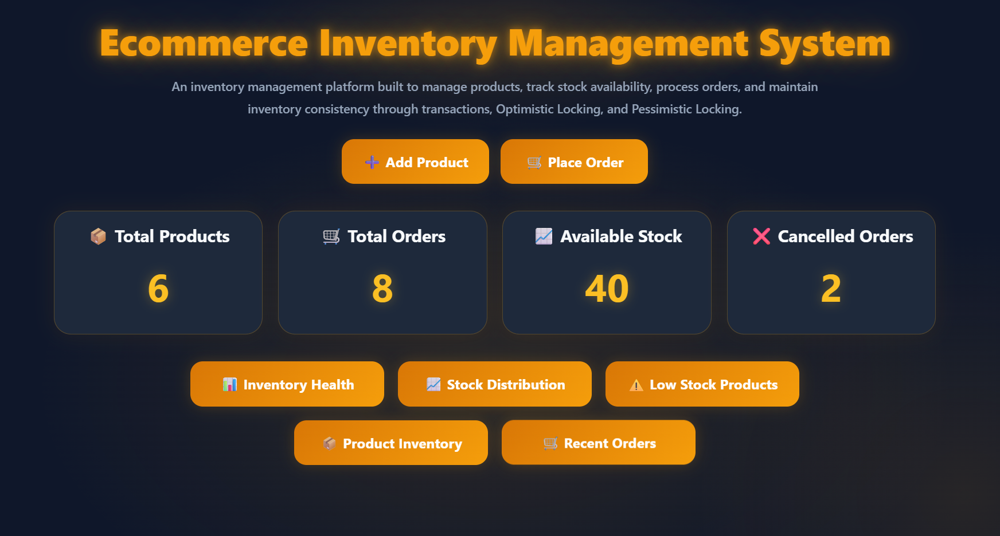
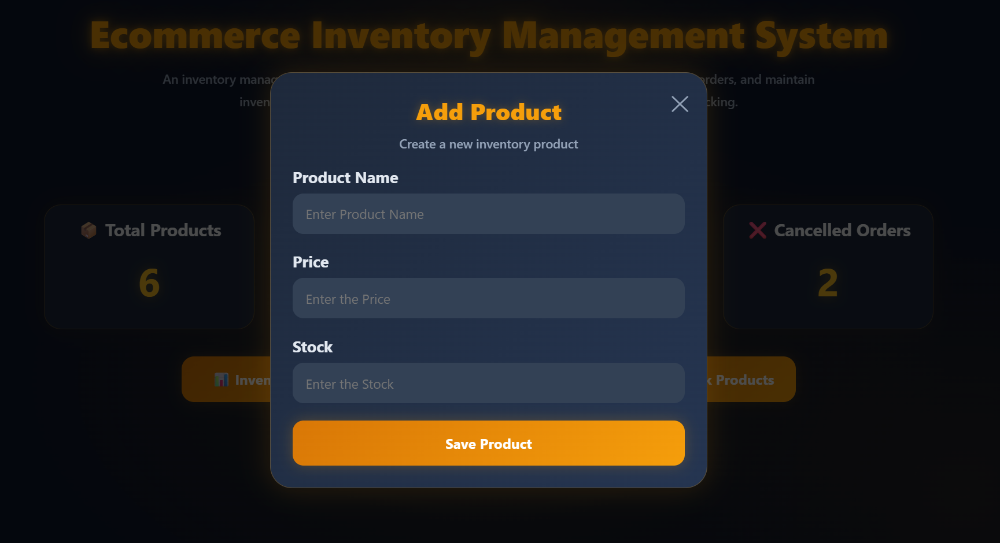
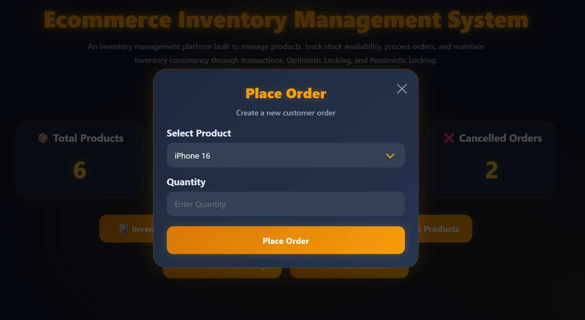
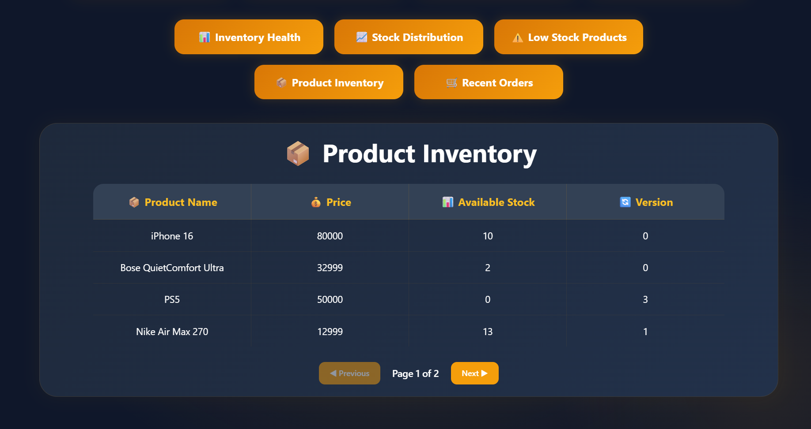
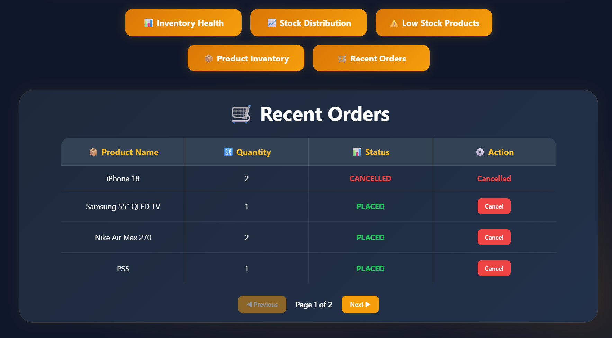
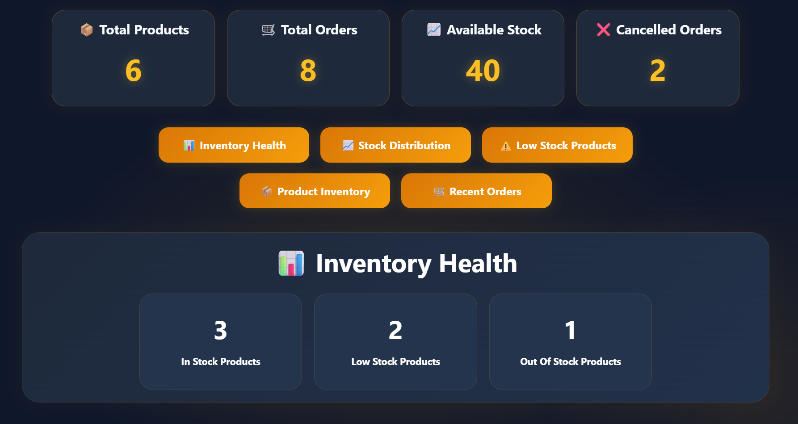
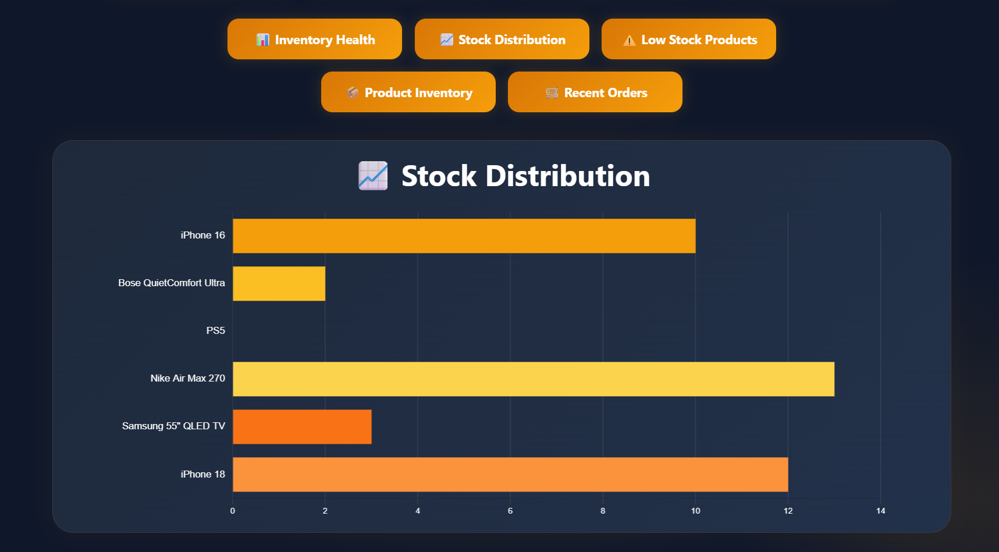
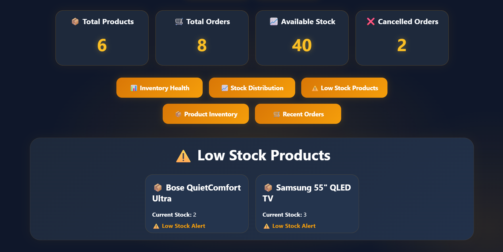

# 🚀 Ecommerce Inventory Management System

A production-oriented Inventory Management System built using Spring Boot, PostgreSQL, JPA, Docker, Optimistic Locking, and Pessimistic Locking that provides product management, inventory tracking, transactional order processing, stock restoration, inventory health monitoring, and a real-time dashboard.

---

# 📖 Overview

This project demonstrates how modern inventory systems maintain stock consistency while handling concurrent inventory updates and transactional order processing.

The application allows products to be managed, orders to be placed and cancelled, inventory levels to be tracked in real time, and stock distribution to be monitored through an interactive dashboard.

The system includes transaction management, inventory restoration on order cancellation, optimistic locking for conflict detection, pessimistic locking for conflict prevention, concurrent inventory update handling, validation, exception handling, and dashboard-based observability.

---

# 📸 Dashboard Preview

## ✅ Dashboard Overview



## ➕ Add Product



## 🛒 Place Order



## 📦 Product Inventory



## 🛒 Recent Orders



## 📊 Inventory Health



## 📈 Stock Distribution



## ⚠️ Low Stock Products



---

# 📌 Features

✅ Product Management

✅ Inventory Tracking

✅ Order Placement Workflow

✅ Order Cancellation & Stock Restoration

✅ Transaction Management using `@Transactional`

✅ Optimistic Locking using Hibernate Versioning

✅ Pessimistic Locking using Database Row-Level Locking

✅ Concurrent Inventory Update Handling

✅ Inventory Health Monitoring

✅ Stock Distribution Analytics

✅ Low Stock Product Monitoring

✅ Product Inventory Tracking

✅ Recent Orders Monitoring

✅ Product & Order Pagination

✅ Add Product Workflow

✅ Place Order Workflow

✅ Interactive Dashboard Sections

✅ Toast-Based User Notifications

✅ Dashboard-Based Inventory Observability

✅ Global Exception Handling

✅ Request Validation

✅ Docker-Based Database Setup

---

# 🛠️ Tech Stack

## Backend

- Java 21
- Spring Boot
- Spring Data JPA
- Spring Validation
- Spring Transactions
- Lombok

## Database

- PostgreSQL

## Frontend

- HTML
- CSS
- JavaScript
- Chart.js

## DevOps

- Docker
- Docker Compose

## Core Concepts

- Transaction Management
- Optimistic Locking
- Pessimistic Locking
- Concurrent Inventory Processing
- Inventory Consistency
- Exception Handling
- Validation
- Inventory Analytics

---

# 🏗️ Architecture

```text
Product Management
        |
        ▼
 ┌─────────────────┐
 │  REST API Layer │
 └─────────────────┘
         |
         ▼
 ┌─────────────────┐
 │ Service Layer   │
 └─────────────────┘
         |
         ▼
 ┌─────────────────┐
 │ Transactional   │
 │ Processing      │
 └─────────────────┘
         |
         ▼
 ┌─────────────────┐
 │ Spring Data JPA │
 └─────────────────┘
         |
         ▼
 ┌─────────────────┐
 │   PostgreSQL    │
 └─────────────────┘
```

---

# 📦 Product Management Flow

Products can be created and managed through REST APIs.

### Available APIs

```http
POST /products

GET /products

GET /products/{id}
```

### Product Entity

```java
Product

id
name
price
stock
version
```

The version field is later used to support Optimistic Locking.

### Example Request

```json
{
  "name": "Nike Air Max 270",
  "price": 12999,
  "stock": 15
}
```

The product is validated and persisted into PostgreSQL.

---

# 🛒 Order Processing Flow

Orders are processed within transactional boundaries to maintain data consistency.

### API

```http
POST /orders
```

### Example Request

```json
{
  "productId": 1,
  "quantity": 2
}
```

### Workflow

```text
Available Stock = 10

Order Quantity = 2

Updated Stock = 8
```

Inventory is automatically updated after successful order placement.

### Transaction Management

All order operations are executed using:

```java
@Transactional
```

to ensure inventory consistency and atomic updates.

---

# 🔄 Order Cancellation & Stock Restoration

Orders can be cancelled and inventory is automatically restored.

### API

```http
POST /orders/{id}/cancel
```

### Workflow

```text
Available Stock = 8

Cancel Order

Updated Stock = 10
```

This demonstrates inventory release and stock restoration concepts.

---

# ⚡ Concurrency Challenge

Consider the following scenario:

```text
Available Stock = 1

User A Places Order

User B Places Order

Both Requests Arrive Simultaneously
```

Without concurrency controls:

```text
Order A ✅

Order B ✅

Stock = -1
```

Result:

```text
Overselling
```

Preventing overselling is one of the primary objectives of this project.

---

# 🔒 Optimistic Locking

The system uses Hibernate Versioning:

```java
@Version
private Long version;
```

### Workflow

```text
Product Version = 5

User A Reads Product

User B Reads Product

User A Updates Product

Version = 6

User B Attempts Update

Version Conflict Detected
```

### Result

```text
Update Rejected

Inventory Remains Consistent
```

When a version conflict occurs, the update is rejected and can be safely retried after fetching the latest product state.

### Concepts Demonstrated

- Optimistic Locking
- Conflict Detection
- Version Tracking
- Concurrent Update Protection

---

# 🔐 Pessimistic Locking

The system also demonstrates row-level database locking using:

```java
LockModeType.PESSIMISTIC_WRITE
```

### Workflow

```text
User A Acquires Lock

User B Requests Same Product

User B Waits

User A Completes

User B Continues
```

### Result

```text
Overselling Prevented
```

Pessimistic Locking prevents simultaneous modification of inventory records under high contention scenarios.

---

# ⚖️ Optimistic vs Pessimistic Locking

| Optimistic Locking | Pessimistic Locking |
|-------------------|---------------------|
| Version Based | Database Lock Based |
| Detects Conflicts | Prevents Conflicts |
| Better for Low Contention | Better for High Contention |
| Higher Throughput | Stronger Consistency |
| Uses `@Version` | Uses `PESSIMISTIC_WRITE` |

---

# 📊 Monitoring Dashboard

The dashboard provides real-time visibility into:

- Total Products
- Total Orders
- Available Stock
- Cancelled Orders
- Inventory Health
- Product Inventory
- Recent Orders
- Stock Distribution
- Low Stock Products

This helps inventory activity and stock levels be monitored efficiently.

---

# 📈 Inventory Health Monitoring

### Healthy Inventory

```text
🟢 In Stock Products

🟡 Low Stock Products

🔴 Out Of Stock Products
```

The dashboard automatically calculates inventory health based on current stock levels.

---

# ✅ Validation & Exception Handling

The application validates all incoming requests before processing.

### Examples

```text
Product Name is Required

Price Must Be Greater Than Zero

Stock Must Be Greater Than Zero

Quantity Must Be Greater Than Zero
```

Global Exception Handling ensures validation and business errors are returned consistently across the application.

---

# ▶️ Running the Application

## Clone the Repository

```bash
git clone https://github.com/your-username/ecommerce-inventory-management-system.git
```

## Navigate to the Project

```bash
cd ecommerce-inventory-management-system
```

## Start PostgreSQL

```bash
docker-compose up -d
```

## Run the Application

```bash
mvn spring-boot:run
```

## Access the Dashboard

```text
http://localhost:8080
```

---

# 🎯 Key Learnings

Through this project, I gained hands-on experience with:

- Spring Boot Application Development
- Product & Inventory Management Workflows
- Transaction Management
- Order Processing Systems
- Order Cancellation & Stock Restoration
- Optimistic Locking
- Pessimistic Locking
- Concurrent Inventory Updates
- Conflict-Based Development Environments

---

# 🚀 Future Enhancements

- Redis Caching
- Product Categories
- Supplier Management
- Inventory Audit Logs
- Inventory Alert Notifications
- Warehouse Management
- JWT Authentication & Authorization
- Role-Based Access Control
- Kubernetes Deployment
- Prometheus Monitoring
- Grafana Dashboards

---

# 👨‍💻 Author

**Jeevitha Rahiman**

*Passionate about Backend Development, Distributed Systems, Concurrency Handling, Transaction Management, and building scalable Java applications.*

---

# 📄 License

This project is licensed under the MIT License.
